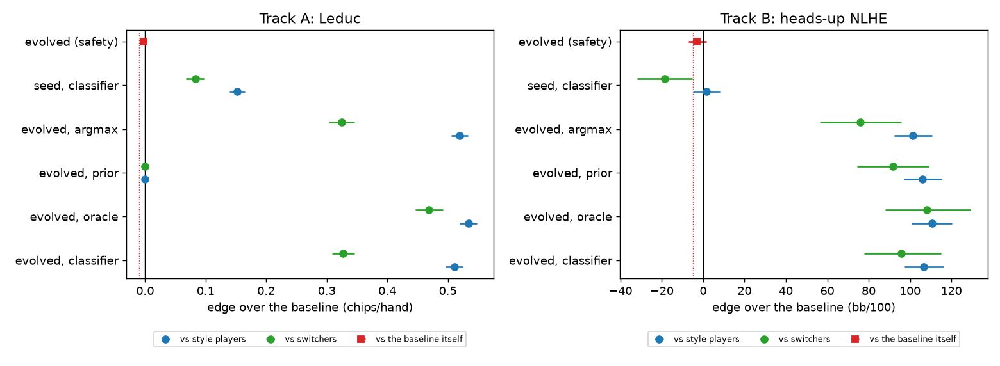
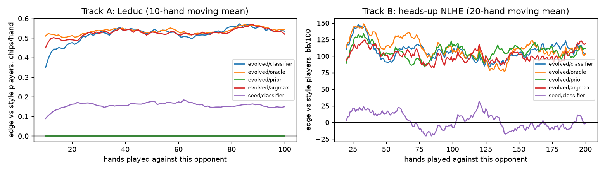
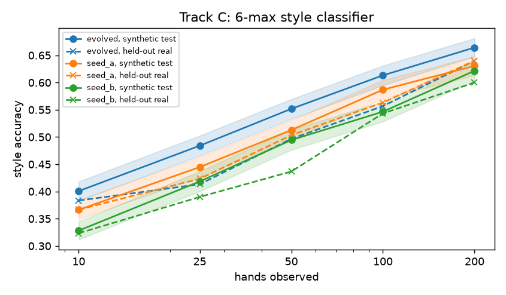

# Results

Phase 7 final experiment `final-v1`, pre-registered in [`configs/final-v1.yaml`](../configs/final-v1.yaml) on 2026-10-24. Every number below comes from run `20261024-210907-final-final-v1`. Re-run with:

```bash
uv run pokerbot final run --config configs/final-v1.yaml
```

All sessions are fresh test-split seeds from index 1,000,000 on, never used by evolution, tuning or an earlier evaluation. The programs are the frozen Phase 5/6 champions and their hand-written seeds. Intervals are 95% bootstrap CIs over sessions; tests are one-sided, with Holm-Bonferroni over the primary hypotheses at family α = 0.01.

## Primary hypotheses

| | Claim | Estimate [95% CI] | p | Holm threshold | Result |
|---|---|---|---|---|---|
| A1 | Leduc: evolved exploiter beats the Nash baseline against style players | +0.511 [+0.497, +0.525] | 0.0e+00 | 0.0014 | **supported** |
| A2 | Leduc: evolved exploiter loses less than the margin to the Nash baseline itself | -0.002 [-0.003, -0.001] | 3.8e-35 | 0.0050 | **supported** |
| A3 | Leduc: evolved exploiter scores higher than the seed (paired fitness) | +0.246 [+0.233, +0.260] | 6.2e-185 | 0.0017 | **supported** |
| B1 | Heads-up: evolved exploiter beats the blueprint against style bots | +106.7 [+97.3, +116.1] | 4.4e-84 | 0.0020 | **supported** |
| B2 | Heads-up: evolved exploiter loses less than the margin to the blueprint itself | -3.0 [-7.2, +1.5] | 1.8e-01 | 0.0100 | not supported |
| B3 | Heads-up: evolved exploiter scores higher than the seed (paired fitness) | +72.284 [+61.864, +82.920] | 1.2e-37 | 0.0033 | **supported** |
| C1 | 6-max: evolved classifier has lower weighted log loss than seed A (paired) | +0.104 [+0.090, +0.118] | 2.4e-39 | 0.0025 | **supported** |

Units: A1/A2 chips per hand; B1/B2 bb/100; A3/B3 the MATH §7.3 session score; C1 the weighted log-loss session score (MATH §6.3). A2/B2 test d > −margin (Leduc 0.01 chips/hand, heads-up 5.0 bb/100).

## Interpretation

Written after the run. It interprets the results; it doesn't change any pre-registered decision.

**The project's question: does the exploiting agent beat the equilibrium baseline against
exploitable opponents?** Yes, in both games where an exploiter exists. In Leduc the evolved
program wins +0.51 chips/hand more than the exact Nash strategy, which itself already wins
0.11–0.49 against these styles. In heads-up no-limit it wins +107 bb/100 more than the MCCFR
blueprint, which itself wins +21 to +37. The gain holds against every style. It also holds
against players who switch style every 25/50 hands (+0.33 and +96).

**Safety against the baseline itself.** In Leduc the loss is 0.002 chips/hand, well inside the
0.01 margin (A2). In heads-up, B2 is **not supported**: −3.0 bb/100 [−7.2, +1.5] on 2,000
blueprint-only sessions, so a loss of up to about 7 bb/100 against an equilibrium opponent
can't be ruled out at the pre-registered 5 bb/100 margin. Phase 6's separate check gave
+2.5 [−5.9, +10.6]. The honest summary is a small loss of 0–7 bb/100 against the blueprint,
against a gain of about 107 against exploitable players. Even so, the exploiter comes out
ahead unless more than about 94% of opponents play like the blueprint.

**What the classifier is for.** The belief ablations agree across both games: calibrated style
probabilities matter mostly for *not* exploiting a player who can't be exploited.

- Leduc: the program exploits only when its beliefs are confident, so with the prior alone it
  plays Nash and gains nothing. With the classifier's top style as a certainty (argmax) it keeps
  the edge (+0.519) but loses 0.135 chips/hand to Nash, against 0.003 with calibrated beliefs.
- Heads-up: the edge doesn't need the classifier (prior only: +106 vs +107); the program reads
  the opponent's own counts. The classifier's contribution is the loss against the blueprint:
  −22.6 [−39.1, −5.7] with the prior only, −11.6 with argmax, −4.9 with the classifier.
- True labels (oracle) add little against fixed styles (+0.02 Leduc, +4 heads-up). They add
  more against switchers (+0.14 and +12): the classifier lags after each switch.

**Evolution vs hand-written code.** The seeds capture a fraction of the edge: +0.15 in Leduc,
and about zero (+1.5 bb/100) in heads-up, where the seed also loses to switchers. Every primary
comparison of evolved vs seed is significant at p < 1e-36. The 6-max classifier gains 2.6–3.9
accuracy points at every checkpoint (66.4% vs 63.1% at 200 hands) and 13% lower log loss at
200 hands. On held-out real players it repeats the Phase 5 numbers: the same players and
deterministic programs give the same values. Its cross-entropy is lower from 50 hands on, and
its accuracy is the same (64% at 200 hands).

**Speed of exploitation.** In Leduc the edge reaches its plateau within about 20 hands. In
heads-up it is there from the first hands, because the program starts from population priors
and the opponent's counts rather than waiting for a label.

**Limits.** All exploiter opponents are calibrated bots. Before claiming anything about people,
the next check is the exploiter against held-out real players' behavior, e.g. against
behavior-cloned opponents.

## Track A — Leduc hold'em (exact values, CFR+ Nash baseline)

1,000 sessions × 100 hands (100,000 hands per row; 70% style, 15% baseline, 15% switcher sessions). The edge d over the baseline is in chips/hand, in duplicate: the same cards and opponents for both.

| Program, beliefs | vs style players | vs the baseline | vs switchers | KL |
|---|---|---|---|---|
| evolved, classifier | +0.511 [+0.497, +0.525] | -0.003 [-0.007, -0.000] | +0.327 [+0.309, +0.346] | 0.396 |
| evolved, oracle | +0.534 [+0.519, +0.548] | +0.000 [+0.000, +0.000] | +0.469 [+0.446, +0.492] | 0.438 |
| evolved, prior | +0.000 [+0.000, +0.000] | +0.000 [+0.000, +0.000] | +0.000 [+0.000, +0.000] | 0.000 |
| evolved, argmax | +0.519 [+0.505, +0.533] | -0.135 [-0.154, -0.116] | +0.325 [+0.303, +0.346] | 0.526 |
| seed, classifier | +0.152 [+0.140, +0.165] | -0.000 [-0.001, +0.001] | +0.083 [+0.068, +0.098] | 0.109 |

Safety, 1,000 baseline-only sessions (indices 1,001,014–1,007,674): evolved -0.002 [-0.003, -0.001] chips/hand (margin −0.01).

Evolved − seed, paired session score: +0.246 [+0.233, +0.260].

Belief ablations: the paired difference in the evolved program's edge vs style players on the same sessions (oracle = true labels, prior = no classifier, argmax = the classifier's top style with no confidence):

- classifier - oracle: -0.023 [-0.031, -0.015] (two-sided p 1e-07)
- classifier - prior: +0.511 [+0.497, +0.525] (two-sided p 0)
- classifier - argmax: -0.009 [-0.017, -0.000] (two-sided p 0.044)

Per style (evolved, classifier beliefs): nit +0.500, calling station +0.564, maniac +0.702, fit-or-fold +0.260, bluffer +0.528.

## Track B — heads-up no-limit hold'em (MCCFR blueprint baseline)

1,000 sessions × 200 hands (200,000 hands per row; 70% style, 15% baseline, 15% switcher sessions). The edge d over the baseline is in bb/100, in duplicate: the same cards and opponents for both.

| Program, beliefs | vs style players | vs the baseline | vs switchers | KL |
|---|---|---|---|---|
| evolved, classifier | +106.7 [+97.3, +116.1] | -4.9 [-21.5, +12.2] | +95.8 [+77.9, +114.9] | 0.442 |
| evolved, oracle | +110.6 [+100.7, +120.4] | +0.0 [+0.0, +0.0] | +108.0 [+88.1, +129.4] | 0.480 |
| evolved, prior | +106.1 [+97.1, +115.4] | -22.6 [-39.1, -5.7] | +91.7 [+74.4, +109.2] | 0.383 |
| evolved, argmax | +101.3 [+92.3, +110.7] | -11.6 [-27.0, +3.8] | +75.9 [+56.6, +95.7] | 0.459 |
| seed, classifier | +1.5 [-4.9, +8.2] | -9.1 [-23.1, +5.2] | -18.6 [-32.0, -5.3] | 0.030 |

Safety, 2,000 baseline-only sessions (indices 1,001,014–1,014,335): evolved -3.0 [-7.2, +1.5] bb/100 (margin −5.0).

Evolved − seed, paired session score: +72.284 [+61.864, +82.920].

Belief ablations: the paired difference in the evolved program's edge vs style players on the same sessions (oracle = true labels, prior = no classifier, argmax = the classifier's top style with no confidence):

- classifier - oracle: -3.9 [-11.3, +3.5] (two-sided p 0.3)
- classifier - prior: +0.6 [-6.7, +7.7] (two-sided p 0.87)
- classifier - argmax: +5.4 [-1.0, +11.8] (two-sided p 0.1)

Per style (evolved, classifier beliefs): HU hyper-aggressor +104.6, HU limper +131.5, HU semi-passive +100.7, HU regular +89.9.

## Track C — 6-max style classifier

480 fresh tables (2,880 seats, 200 hands each) and 300 held-out real players (used once before, in Phase 5).

| Program | acc@10 | acc@25 | acc@50 | acc@100 | acc@200 | log loss@200 |
|---|---|---|---|---|---|---|
| evolved | 0.401 | 0.484 | 0.552 | 0.613 | 0.664 | 0.908 |
| seed_a | 0.366 | 0.445 | 0.513 | 0.587 | 0.631 | 1.044 |
| seed_b | 0.328 | 0.418 | 0.494 | 0.547 | 0.622 | 1.023 |

Held-out real players: accuracy against argmax q / cross-entropy H(q, p):

| Program | @10 | @25 | @50 | @100 | @200 |
|---|---|---|---|---|---|
| evolved | 0.383 / 1.642 | 0.413 / 1.431 | 0.497 / 1.275 | 0.557 / 1.057 | 0.640 / 0.926 |
| seed_a | 0.367 / 1.634 | 0.423 / 1.418 | 0.503 / 1.288 | 0.563 / 1.114 | 0.640 / 1.010 |
| seed_b | 0.323 / 1.846 | 0.390 / 1.610 | 0.437 / 1.419 | 0.543 / 1.168 | 0.600 / 0.972 |

- evolved - seed_a, paired session score: +0.104 [+0.090, +0.118], p 2.4e-39
- evolved - seed_b, paired session score: +0.231 [+0.204, +0.258], p 1.3e-50

## Plots







## Champion lineage

Each champion's ancestry, newest first, back to its hand-written seed, from the evolution runs' candidate records.

**Track A exploiter** (`programs/exploiter_leduc/champion-20261021-204914-evolve-exploiter-leduc.py`):

- `20261021-204914-evolve-exploiter-leduc` g02-5 (gen 2): Use per-style Bayesian hand-range inference and one-step chip-EV lookahead (fold equity, pot odds, value when called) to tilt the Nash baseline, with observed-frequency correction and confidence gating.
- `20261021-204914-evolve-exploiter-leduc` g01-7 (gen 1): Blend the Bayesian style centers with this opponent’s own observed open/facing frequencies, weighted by sample size, and use the corrected fold/call/bluff tendencies (plus medium-card bluffing) to tilt the Nash baseline.
- hand-written seed `seed`

**Track B exploiter** (`programs/exploiter_hu/champion-20261022-230930-evolve-exploiter-hu-2.py`):

- `20261022-230930-evolve-exploiter-hu-2` g05-2 (gen 5): Make each bet size's fold equity size-dependent (bigger bets get fewer folds) so the EV of a bluff is judged against its own break-even fold rate B/(P+B) per style, and add a trap bonus that values checking strong hands into hyper-aggressive opponents who will bet for us.
- `20261022-230930-evolve-exploiter-hu-2` g02-4 (gen 2): Use per-style fold/call odds to form each action's EV—including the B/(P+B) bluff threshold—and softmax toward the highest-EV action while keeping the existing style-tilt and postflop c-bet exploits.
- `20261022-230930-evolve-exploiter-hu-2` g01-1 (gen 1): Hoist repeated per-size bet/call payoff terms and keep only the validated style and street adjustments, preserving the tuned exploiter behavior.
- run `20261022-230930-evolve-exploiter-hu-2` started from `programs/exploiter_hu/candidate-g04-0-20261022-170121-evolve-exploiter-hu.py`
- `20261022-170121-evolve-exploiter-hu` g04-0 (gen 4): Add street-aware postflop tilts that use style-specific fold-to-c-bet and c-bet/aggression excesses to size continuation bets, bluff-catch more versus high-c-bet aggressors, value-raise strong hands, and suppress weak bluffs into calling/aggressive styles.
- `20261022-170121-evolve-exploiter-hu` g03-1 (gen 3): Target hyper-aggressive styles by using observed/prior aggression excess to penalize weak bluffs, increase bluff-catching calls, and boost value raises while leaving passive/equilibrium opponents nearly untouched.
- `20261022-170121-evolve-exploiter-hu` g02-3 (gen 2): Blend each style’s fold-to-bet and aggression priors with the opponent’s own observed `opp.n/opp.x` counts, so the EV tilt exploits actual deviations from the classifier rather than only the presumed style.
- `20261022-170121-evolve-exploiter-hu` g01-1 (gen 1): Model each action's EV per style using fold/aggression rates and pot odds, adjust equity for calling/raising ranges, and tilt the blueprint toward the best EV.
- hand-written seed `seed`

**Track C classifier** (`programs/classifier/champion-20261021-064929-evolve-classifier-sh.py`):

- `20261021-064929-evolve-classifier-sh` g22-5 (gen 22): Extend the redundancy map from "cross-family only" to every pair of stats whose style-mean directions agree (vpip_EP vs vpip_MP, vpip_d0 vs vpip_d1, vpip vs pfr, agg_flop vs cbet_flop), so a family of near-identical stats is diluted by the same smooth correlation discount instead of only by the crud
- `20261021-064929-evolve-classifier-sh` g21-5 (gen 21): Add a within-style correlation matrix estimated from the per-style covariances so redundant Beta-Binomial evidence is downweighted and the Gaussian observation noise is correlated across stats that measure the same trait.
- `20261021-064929-evolve-classifier-sh` g17-4 (gen 17): Replace the single additive log-pool of the count-based Beta–Binomial evidence and the correlation-aware Gaussian evidence with a calibrated mixture that averages the pooled posterior with each expert's own posterior (hedging when the two likelihood models disagree), controlled by a tunable mixing k
- `20261021-064929-evolve-classifier-sh` g15-2 (gen 15): Add calibrated shape experts for position and stack-depth splits, a Dirichlet–multinomial bet-size histogram expert, and a shown-hand strength contrast to separate position-blind, limping, and aggressive styles without overconfidence.
- `20261021-064929-evolve-classifier-sh` g10-1 (gen 10): Add honest Beta–Binomial "conditional composition" experts — PFR-per-VPIP raise share (separates loose-aggressive fish from loose-passive), limp share of played hands (separates passive limpers), and late-vs-all positional VPIP share (separates position-blind aggressors) — since these subset/base ra
- `20261021-064929-evolve-classifier-sh` g09-5 (gen 9): De-duplicate correlated Beta–Binomial evidence with a style-mean similarity penalty, and add orthogonal PFR/VPIP-ratio and positional-gradient contrast experts so the removed redundancy is replaced by genuinely new signal.
- `20261021-064929-evolve-classifier-sh` g07-0 (gen 7): Add a direct session buy-in stack-depth expert (from HandStart) that identifies short-stackers from hand 1, plus an explicit early limp-rate expert, both as tunable auxiliary logits that don't depend on sparse split stats.
- `20261021-064929-evolve-classifier-sh` g06-5 (gen 6): De-duplicate correlated statistics by grouping nested/split counts (VPIP/PFR/RFI by position and stack depth, per-street cbet/agg/donk/xr, and bet-size bins) into shared evidence families and rebalancing the Beta-Binomial weight budget instead of counting each split as independent.
- `20261021-064929-evolve-classifier-sh` g02-2 (gen 2): Add auxiliary evidence from stack-depth exposure (rare style), bet-size histogram aggression, and early-position PFR aggression, with tunable weights and confidence shrinkage for calibration.
- run `20261021-064929-evolve-classifier-sh` started from `programs/classifier/champion-20261021-002216-evolve-classifier-sh.py`
- `20261021-002216-evolve-classifier-sh` g03-1 (gen 3): Reweight the marginal Beta-Binomial evidence per feature by a profile-derived Fisher discriminative ratio (between-style mean spread vs within-style variance), boosting limp/steal/3-bet, position & stack-depth splits and street aggression so passive limpers, loose-passives and position-blind aggress
- `20261021-002216-evolve-classifier-sh` g02-0 (gen 2): Combine exact Beta-Binomial marginal evidence with a full-covariance Gaussian likelihood in standardized logit space whose per-feature noise variance `s2` grows for sparse counts, so early VPIP/PFR/RFI/limp/steal evidence is used but deep sparse stats are automatically downweighted.
- hand-written seed `seed_a.py`

## Caveats

- Opponents are calibrated synthetic bots (Phase 3). Only the classifier is checked on real players; the exploiters have not played real people.
- The Leduc baseline is an exact equilibrium. The heads-up baseline is an abstracted MCCFR blueprint, so heads-up edges and margins are relative to that approximation.
- No 6-max (Track C) exploiter was built; Track C covers classification only.
